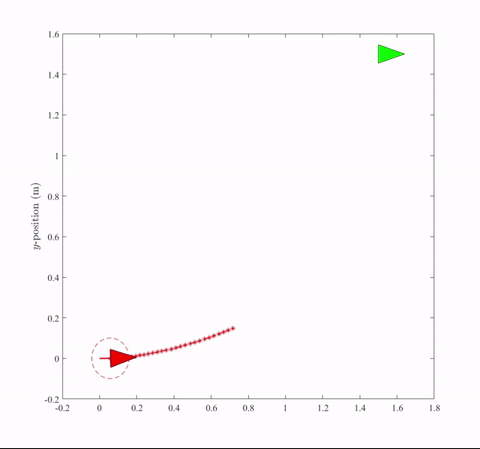

# MPC for Autonomous Underwater Vehicle (AUV) — Point Stabilization

Graduation project: a Nonlinear Model Predictive Controller (NMPC) for horizontal-plane point stabilization of a differential-thrust Autonomous Underwater Vehicle, formulated as an NLP and solved with [CasADi](https://web.casadi.org/) + IPOPT. A separate depth-axis PID controller, designed and tested independently, handles the vertical channel.

## Contents

- [Demo](#demo)
- [Repository structure](#repository-structure)
- [Dependency: CasADi (not included)](#dependency-casadi-not-included)
- [Horizontal-plane NMPC — `matlab/`](#horizontal-plane-nmpc--matlab)
- [Depth control — `depth_control/`](#depth-control--depth_control)
- [C++ / ROS-oriented port — `ros_cpp/`](#c--ros-oriented-port--ros_cpp)
- [Known differences between the MATLAB and C++ controllers](#known-differences-between-the-matlab-and-c-controllers)
- [Background](#background)

## Demo

Simulation result: AUV starts at the origin and stabilizes to the reference pose `(x, y, ψ) = (1.5, 1.5, 0)`, using the horizontal-plane NMPC.



Full video: [`media/Untitled_video_-_Made_with_Clipchamp.mp4`](media/Untitled_video_-_Made_with_Clipchamp.mp4)

With the tuning in [`matlab/AUV_MPC.m`](matlab/AUV_MPC.m), this run settles in ~17.3 s with negligible steady-state error (see commented notes at the bottom of that file for the exact overshoot/settling numbers from this tuning pass).

## Repository structure

```
.
├── matlab/
│   ├── AUV_MPC.m                          # NMPC formulation, IPOPT solve loop, main entry point
│   ├── Draw_MPC_point_stabilization_v1.m  # Animates the closed-loop trajectory + control effort plots
│   └── shift.m                            # Plant propagation + control-sequence shift for the receding-horizon loop
├── depth_control/
│   ├── model_script_sim.m                 # Standalone discrete PID + hand-derived depth plant, run directly in MATLAB
│   ├── Discrete_PID.m                     # Parallel-form discrete PID used by model_script_sim.m
│   ├── Depth_stabilizer.slx               # Separate Simulink PD depth model (PID Controller block + transfer-function plant)
│   └── depth_stabilizer_result.jpg        # Depth response plot, most likely from the Simulink scope (see note below)
├── ros_cpp/
│   └── ROS_control_node_MPC_PID.cpp       # C++ NMPC (reduced model) + depth PID, written ahead of ROS integration
├── media/
│   ├── mpc_convergence_demo.gif
│   └── Untitled_video_-_Made_with_Clipchamp.mp4
└── README.md
```

## Dependency: CasADi (not included)

This project is built on **CasADi**, a symbolic framework for algorithmic differentiation and numerical optimization. CasADi is a third-party dependency (LGPL-licensed, ~hundreds of MB with prebuilt solver binaries per platform) — it is **not vendored in this repo** and should not be. Install it separately:

- CasADi: <https://web.casadi.org/get/>
- The MATLAB script assumes a local CasADi install and adds it to the path explicitly:
  ```matlab
  addpath('D:\ASMarine\casadi-windows-matlabR2016a-v3.5.5')
  ```
  **Update this path** to wherever CasADi is installed on your machine before running.
- The C++ file links against the CasADi C++ API (`#include <casadi/casadi.hpp>`) and IPOPT as the underlying NLP solver — both need to be built/installed and discoverable by your build system.

## Horizontal-plane NMPC — `matlab/`

**Model** — 6 states `[x, y, ψ, u, v, r]`, 2 controls `[T1, T2]` (per-thruster forces from a differential thrust pair mounted at `AUV_radius` from the CG). Surge/sway drag and yaw drag are modeled with added-mass terms (`Xu_dot`, `Nr_dot`).

**Controller** — shooting-based NMPC over a horizon `N = 30` (`T = 0.1 s` per step → 3 s lookahead), quadratic tracking cost on `(x, y, ψ)`, box constraints on thruster force (`±12 N` per file), and box constraints on `(x, y)` for map-margin limits. Solved fresh every step with IPOPT via `nlpsol`, receding-horizon style. `shift.m` propagates the "true" plant state forward one step using the actual nonlinear dynamics and shifts the control sequence to warm-start the next solve — this is what makes the loop in `AUV_MPC.m` a proper receding-horizon simulation rather than a single open-loop solve.

**Run it:**
```matlab
addpath('/path/to/casadi')   % update this in AUV_MPC.m first
AUV_MPC
```
`AUV_MPC.m` calls `Draw_MPC_point_stabilization_v1.m` automatically at the end of the simulation loop to animate the result and plot control effort.

## Depth control — `depth_control/`

The vertical (depth) channel is **not covered by the NMPC** — it was designed and tested as a separate, independent single-axis PID controller. This folder holds two distinct artifacts from that work, not one script and its Simulink equivalent:

**1. `model_script_sim.m` + `Discrete_PID.m`** — a standalone discrete PID controller (parallel form, numerical integration via a global accumulator) driving a hand-derived depth plant (`z_ddot = (F - Ft) / (m + added_mass)`, a simple double integrator under thrust). Gains: `kp = 54.6, ki = 0, kd = 286.4`, target depth `setpoint = 3`. Fully self-contained — `clear; clc;` at the top of `model_script_sim.m` and run it directly, no CasADi or toolboxes required.

**2. `Depth_stabilizer.slx`** — a separate Simulink model: a **PD**-mode PID Controller block (`P = 10, D = 100`) feeding a `TransferFcn` plant (denominator `[197, 0, 0]`, i.e. `1/(197·s²)`), with a step reference and a step disturbance injected downstream of the controller. This is an independent design pass, not a Simulink port of `model_script_sim.m` — the gains and plant coefficients don't match between the two, though both are PD-type controllers stabilizing a double-integrator-like depth plant.

**About `depth_stabilizer_result.jpg`:** this is most likely the scope capture from `Depth_stabilizer.slx` rather than output from `model_script_sim.m` — the plot title ("Depth Stabilizer") and y-axis label ("Depth(m)") match what Simulink auto-generates from the model name and scope, whereas `model_script_sim.m` as written only calls a bare `plot(timeline, z)` with no title or axis labels set. Both controllers produce a qualitatively similar response shape (rise, mild overshoot, settle), so if you want the response plot for one specific one of these two controllers, regenerate it directly rather than relying on this image.

## C++ / ROS-oriented port — `ros_cpp/`

`ROS_control_node_MPC_PID.cpp` was written as **preparatory algorithm-porting work ahead of full ROS integration** — translating the NMPC formulation and adding the depth PID/PWM logic in C++, before wiring it into an actual ROS node (subscribers, publishers, node lifecycle). That ROS integration was completed and working at the time, but the node source is no longer available — only this preparatory version survives. As uploaded, it reflects that intermediate stage:

- **5 states** `[x, y, ψ, u, r]` — sway (`v`) is dropped, since it isn't independently actuated.
- **Controls are `[Force, Torque]`** directly, rather than per-thruster `[T1, T2]` — thrust allocation was intended to happen downstream, likely in the (now-lost) ROS node.
- Shorter horizon (`N = 15`) and different weight tuning, aimed at a real-time control-loop context rather than an offline simulation study.
- Includes the **depth PID loop** (thrust → PWM via an 8th-order polynomial fit, clamped to actuator limits) inline alongside the NMPC — in the finished system this and the NMPC likely ran as part of the same node.
- No `#include <ros/ros.h>` or publisher/subscriber/node setup — that layer lived in the ROS node this was written for, and isn't present here.
- A few loose ends consistent with pre-integration code: missing includes (`<cmath>` for `pow`/`fabs`), and `pi`, `depth`, `TRUE`/`FALSE` referenced but not defined in this file — likely provided elsewhere in the original node.

Treat this file as the NMPC + depth-control **algorithm reference** from that stage of the project, not a drop-in ROS node.

## Known differences between the MATLAB and C++ controllers

Worth stating explicitly rather than leaving implicit: the MATLAB and C++ horizontal-plane controllers are **not** the same controller in two languages. They diverge in state dimension, control parameterization, horizon length, and weight tuning. The MATLAB version was the design/tuning testbed; the C++ version reflects the simplification made in preparation for the real-time ROS context. If you extend either one, keep this in mind before assuming a fix in one applies to the other.

## Credits

This project's NMPC formulation and MATLAB structure (`shift.m`, `Draw_MPC_point_stabilization_v1.m`, the CasADi/IPOPT shooting setup) is built directly on **Mohamed W. Mehrez's** MPC/MHE workshop:

- Repo: <https://github.com/MMehrez/MPC-and-MHE-implementation-in-MATLAB-using-Casadi>
- Lecture recordings: <https://www.youtube.com/playlist?list=PLK8squHT_Uzej3UCUHjtOtm5X7pMFSgAL>

Per that repo's request, if you use this work academically, please cite Mehrez's related publications (listed on his [Google Scholar](https://scholar.google.ca/citations?user=aRNeH4QAAAAJ&hl=en)) alongside this project.

